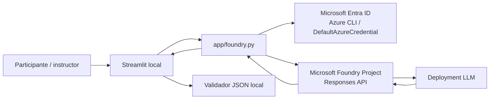

# Arquitectura y alcance

## Qué SÍ hace este demo:

- Envía prompts, usando el SDK Python `azure-ai-projects` y `get_openai_client().responses.create()`.
- Usa autenticación Entra ID con credenciales locales de Azure CLI.
- Muestra prompt, respuesta, identificador de respuesta y recuento de tokens cuando lo proporciona el servicio.
- Permite editar prompts en modo instructor, hacer seguimiento y exportar el historial.
- Valida con Python el **esquema básico** de la clasificación JSON.

## Qué NO hace este demo aún:

- No está conectado a pedidos, CRM, ERP ni soporte real.
- No utiliza RAG, embeddings, Azure AI Search ni un agente autónomo.
- No verifica hechos externos ni garantiza ausencia de alucinaciones.
- No incluye autenticación multiusuario ni despliegue cloud; Streamlit es una app local educativa.
- No usa secretos de aplicación ni almacena datos salvo que se exporten o active `SAVE_RUNS=true`.

## Consideraciones para empresa

Antes de producción: 

- Aplicar identidad administrada
- Aplicar permisos mínimos
- Incluir controles de red
- Revisar el tratamiento de datos
- Realizar evaluaciones sistemáticas
- Incluir supervisión humana
- Considerar límites de uso
- Proteger el contenido
- Observar la telemetría
- Revisar los costos. 
- No publicar este servidor Streamlit directamente a Internet sin un diseño de autenticación y seguridad adecuado.
